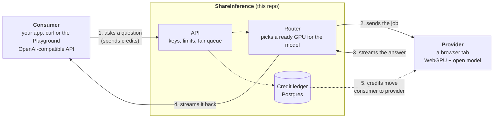

# ShareInference
[](https://github.com/juliomatcom/shareinference.com/actions/workflows/ci.yml)

An open-source, community-powered AI inference network. People share spare GPU compute straight from a browser tab (WebGPU, no install) and earn credits; credits are spent through an OpenAI-compatible API to run open-weight models. The server only orchestrates, routes and keeps the credit ledger — all inference runs in contributors' browsers.

## How it works



1. **Providers** open the Share page, turn sharing on, and their browser loads an open-weight model onto the GPU (WebLLM, no install). They keep a WebSocket open to the API.
2. **Consumers** call the OpenAI-compatible API (or the web Playground) with an API key. The model is chosen by the consumer; the provider is chosen blindly by the router and never sees who asked.
3. The API orchestrates only: it queues the request (priority lane for credit holders, a fair queue for everyone else), sends it to a ready GPU, relays the streamed answer, and settles credits in one database transaction. Inference itself never runs on our servers.
4. Providers **earn** credits for the tokens they serve (1 per input token, 5 per output token); consumers **spend** them. Credits only move between users, they are never burned.

Prompts are processed in a contributor's browser, so treat them as shared with a stranger's machine; we store only metadata (model, token counts, credits, timings), never prompt or answer text. See [`docs/privacy.md`](docs/privacy.md).

## Status

The MVP works end to end: GitHub sign-in, API keys, a one-model catalog (`qwen3.5-4b`), browser GPU sharing that keeps running while you browse, a credit ledger, a Playground, a dashboard with paged ledger and history, and a public leaderboard. Early days, so expect rough edges. The plan, decisions and verification log live in [`specs/mvp-plan.md`](specs/mvp-plan.md).

## Quickstart

Requires Docker Engine 25+ and Docker Compose 2.20+. Development also needs Node 24 and pnpm (via `corepack enable`).

```sh
cp .env.example .env          # then set POSTGRES_PASSWORD (openssl rand -hex 16) and the GitHub OAuth app values
docker compose up -d --build
```

- Web: <http://localhost:4400> · api: <http://localhost:4401/healthz> (host ports `WEB_PORT` / `API_PORT`)
- Developing: `docker compose stop api web`, set `DATABASE_URL` host to `127.0.0.1` and `PORT=4401` in `.env`, then `pnpm dev` (live reload for api and web)
- Step by step, including the GitHub OAuth app and the admin CLI: [`docs/setup.md`](docs/setup.md).
- Putting it on a public server (Caddy with automatic HTTPS, backups, deploy script): [`docs/deploy.md`](docs/deploy.md).
- Lending your GPU (what you need, how it works): [`docs/contribute.md`](docs/contribute.md).
- Using the OpenAI-compatible API (curl and the OpenAI SDK; the hosted instance is `https://api.shareinference.com/v1`): [`docs/api.md`](docs/api.md).
- Data lives in the `db-data` volume and survives restarts; `docker compose down -v` deletes it.
- The database password is fixed when the volume is first created; changing it later requires `docker compose down -v`.
- Avoid `$` in passwords (compose treats it as interpolation) and percent-encode `@`, `/` and `:` in `DATABASE_URL`.

## License

[AGPL-3.0](LICENSE). Vendored agent skills keep their own licenses, see [`.agents/skills/LICENSES`](.agents/skills/LICENSES/README.md).
