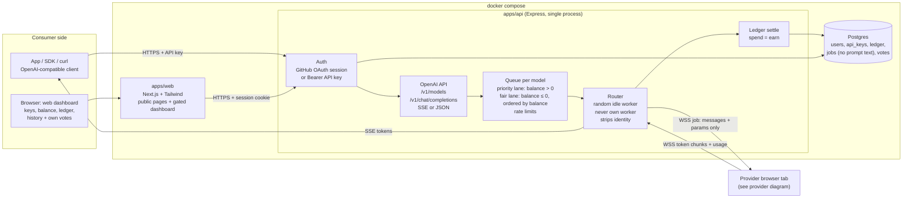
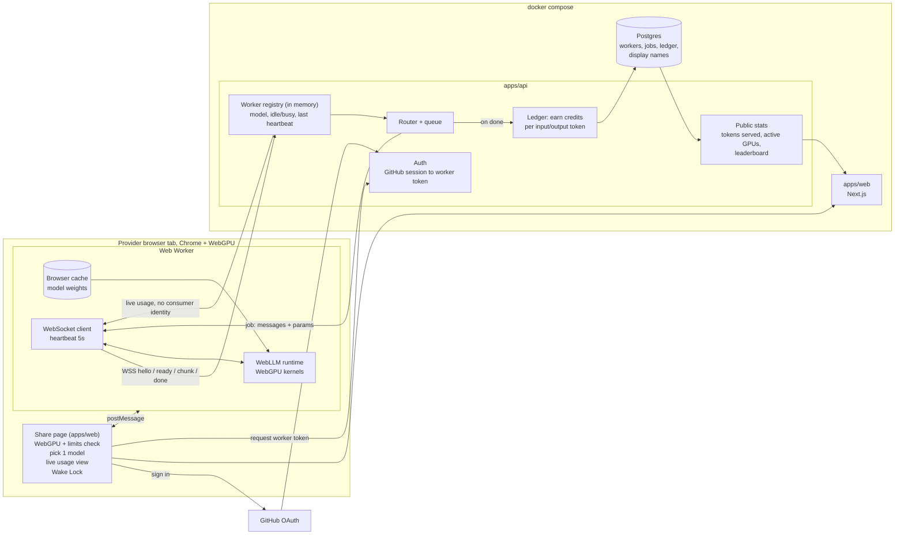

# ShareInference — MVP Plan

Living plan, the single planning document (the original Gemini draft `Initial-v1.md` was folded in here and deleted).

**Vision:** ShareInference (`shareinference.com`) is an open-source, community-powered AI inference network. People share spare GPU compute from a browser tab (no install) and earn credits; credits are spent through an OpenAI-compatible API to run open-weight models. The server is only an orchestrator, router and credit ledger — it has no GPUs; all inference runs in contributors' browsers.
Rule: a decision enters **Decided** only after it was verified (spike, doc check, or explicit user call). Everything else stays in **To verify** or **Open questions**.

---

## Architecture at a glance

### Consumer (spends credits)

### Provider (earns credits)

---

## 0. MVP definition

**One sentence:** a consumer with an API key sends `POST /v1/chat/completions` (stream or not) to our server, the request runs on a contributor's browser tab that has that model loaded, tokens stream back, and credits move from consumer to contributor (minus a burn) in a ledger.

**In MVP**

- GitHub-login accounts, sessions, API keys (hashed).
- Contributor "Share" page: WebGPU check → pick **one** model → load in a Web Worker → connect WebSocket → serve jobs one at a time.
- `GET /v1/models` (only models with ≥1 online worker), `POST /v1/chat/completions` (SSE + non-stream).
- In-memory worker registry + per-model queue (single api process) with **two lanes**: free users in a fair queue, credit holders jump ahead (priority routing, D12).
- Free tier: users with zero balance can still run inference through the fair queue (economics in Q9).
- Append-only credit ledger: sign-up grant, spend, earn, burn. Contributors earn per served token (Q10).
- Public site (D12/D14): landing with live "tokens served" + active GPU count, How It Works, Model Catalog (models + online workers + queue), Leaderboard (top providers), Docs, link to repository.
- Signed-in dashboard: balance, ledger, API keys, own worker stats.
- Admin CLI (`pnpm users …`, `pnpm credit …`) like agthy.
- `docker compose up` brings up postgres + api + web and it works.

**Not in MVP** (later phases): canary verification + reputation, donations/Stripe, multiple models per worker, horizontal api scaling, user-reported garbage flow.

---

## 1. Decided

| #   | Decision                                                                                                                                   | Verified by                     |
| --- | ------------------------------------------------------------------------------------------------------------------------------------------ | ------------------------------- |
| D1  | Monorepo with pnpm workspaces: `apps/api`, `apps/web`, (later `libs/*`). Node 24, ESM, TypeScript strict.                                  | user + agthy.com reference      |
| D2  | `apps/api`: Express 5, `ws` for WebSockets, knex + pg, zod validation, vitest. Clean-architecture split `core/` (pure) ← `adapters/` ← `main.ts`. | user + agthy.com reference      |
| D3  | Migrations via knex, run by `pnpm db:migrate` and also on api start (agthy pattern `src/migrate.ts`).                                      | agthy.com reference             |
| D4  | CLI commands as separate entrypoints in `apps/api/src/*.ts` (`users.ts`, …) exposed as root `pnpm` scripts.                                 | agthy.com reference             |
| D5  | `apps/web`: Next.js + Tailwind 4, no backend of its own — everything server-side lives in `apps/api` (agthy rule).                          | user + agthy.com reference      |
| D6  | Postgres 17 in compose; single `compose.yaml` at repo root; multi-stage Dockerfiles with repo root as build context.                       | user + agthy.com reference      |
| D7  | 1 request → 1 worker, whole model on that worker. No layer splitting.                                                                      | original spec                   |
| D8  | Platform access is **GitHub OAuth only** (no passwords, no email provider in MVP). User row keyed by GitHub user id; api issues its own session cookie after the callback. | user (2026-11-20)               |
| D9  | **Everything is gated to authenticated users.** Public surface is only: web sign-in page, `GET /auth/github`, `GET /auth/github/callback`, `GET /healthz` (compose healthcheck). Dashboard/web API routes need a session cookie; `/v1/*` needs a Bearer API key (which itself belongs to a GitHub user); worker WS needs a token issued to a session. Network status is not public. | user (2026-11-20)               |
| D10 | **One root `.env`** holds every secret and setting for all services (compose `env_file: [.env]`). `.env` is git-ignored; `.env.example` is committed with every variable documented (purpose, how to generate, required/optional). Required secrets fail fast at startup and in compose (`${VAR:?…}`). Secrets are read from env only — never in source, images, logs or API responses. | user (2026-11-20)               |
| D11 | **Open source ⇒ secure by design, documented, easy to set up.** No security through obscurity: assume attackers read the code (server verifies, client is untrusted). Setup target: clone → `cp .env.example .env` → add GitHub OAuth id/secret (+ a generated session secret) → `docker compose up` works. Every phase ships its docs; each phase's check includes the security items in §4a. | user (2026-11-20)               |
| D12 | **Design reference = MVP scope reference:** [`design/landing.png`](design/landing.png) is accurate for both look and functionality. Dark theme, green accent, circuit-board hero; header (logo, How It Works, Model Catalog, Leaderboard, Docs, View Repository, Sign In); hero "N tokens served" + live active GPU count; cards "Provide inference (earn credits)" / "Access inference (spend credits)"; "Top GPU providers" table (rank, contributor, device, model hosted, tokens served, credits earned, status); footer: fair queue for free users, priority for credit holders, AGPL-3.0. | user (2026-11-20) |
| D13 | License **AGPL-3.0** (already in `LICENSE`, matches design footer). | `LICENSE` file |
| D14 | **D9 refined by D12:** public = read-only pages (landing, How It Works, Model Catalog, Leaderboard, Docs) + **aggregate** stats endpoints. Everything that acts or exposes per-user private data (dashboard, keys, ledger, Share mode, `/v1/*`, worker WS) stays gated. | user (2026-11-20) |
| D15 | **Leaderboard name:** defaults to the GitHub login; the user can set a public display name in Settings (validated length/charset, unique, cannot equal another user's GitHub login). | user (2026-11-20) |
| D16 | **Contributors see their GPU usage live:** Share page + dashboard show, in real time, jobs running/served, input/output tokens, tokens/sec and credits earned. Never shown: who the consumer is or the prompt/output content. (Honest caveat for `docs/security.md`: the prompt is decrypted inside the contributor's browser, so a technical contributor could read it with devtools — the UI just never displays it.) | user (2026-11-20) |
| D17 | **Routing is random and blind.** Consumer chooses only the model; the router assigns any eligible idle provider. The provider's public name (D15) is revealed to the consumer **only after the job ends** (dashboard request history: "served by"), never during the stream. | user (2026-11-20) |
| D18 | **Provider votes:** a signed-in user can vote on a provider only if that provider served them (checked against `jobs`), once per provider. Votes are a quality/trust signal (garbage output, wrong model); expected to correlate with tokens served. Weighting and use in trust score are decided in the anti-cheat phase. **MVP visibility:** votes are private — no public counts, not on the leaderboard, not shown to providers; a user sees only their own votes, in their request history. Stored server-side for the later trust score. | user (2026-11-20) |
| D19 | **`wiki-llm/` is the source of truth, written for agents** (agthy pattern), and agreed **before any product code**. Code follows the wiki; a change to a flow, contract, rule or number updates the wiki in the same commit. `docs/` holds **user-friendly docs** for humans (setup, API usage, contributing GPU); they are not a source of truth, follow the wiki, and the wiki wins on conflict. `specs/` holds proposals and history (incl. this plan); decided items move into the wiki. `AGENTS.md` points agents to `wiki-llm/index.md`. | user (2026-11-20) |
| D20 | **No debt floor.** Negative balances are unbounded. Abuse is contained by: (a) rate limits per user for the free/negative lane (requests/min, requests/day, max concurrent), (b) an admin CLI to throttle or suspend a user manually, (c) queue position — the more negative the balance, the further back in the fair lane (see `routing.md`). | user (2026-11-20) |
| D21 | **Never route a job to a worker owned by the consumer's own account.** | user (2026-11-20) |
| D22 | **Free tier requires a GitHub account ≥ 1 month old** (checked from GitHub `created_at` at sign-in; younger accounts can still use credits they hold or earn). | user (2026-11-20) |
| D23 | **Build the minimum necessary.** Every phase ships the smallest thing that proves its check; extras go to a later phase. | user (2026-11-20) |
| D24 | **Browser runtime: WebLLM `@mlc-ai/web-llm@0.2.89`** (npm latest, published 2026-11-17), loaded pinned from jsDelivr (`https://cdn.jsdelivr.net/npm/@mlc-ai/web-llm@0.2.89/+esm`). Engine runs in a dedicated Web Worker; cache backend is configurable (`appConfig.cacheBackend`: cache / indexeddb / opfs). | npm registry + WebLLM docs + `src/config.ts` |
| D25 | **First model: Qwen3.5-4B** (HF `Qwen/Qwen3.5-4B`) → WebLLM prebuilt `Qwen3.5-4B-q4f16_1-MLC`, ~3.9 GB VRAM, 4096-token context. | user + `config.ts` |
| D26 | **Postgres data on a named Docker volume** (`db-data`) so restarts and `docker compose down` keep data; only `down -v` deletes it (documented). | user (2026-11-20) |
| D27 | **Worker calls `resetChat()` before every job.** No KV-cache reuse across requests: every request processes its full message history, so price depends only on the request (not on routing luck) and no consumer state stays in GPU memory between jobs. Conversations remain resumable: the consumer resends the full history (stateless OpenAI API). | user (2026-11-20) |
| D28 | **Thinking tokens are output tokens** and are billed as such (Qwen3.5 thinks by default). | user (2026-11-20) |
| D29 | **Database is swappable by one URL.** The api reads only `DATABASE_URL` (incl. `sslmode`); no host/port/user split vars. Local default: compose `db` service (Postgres 17, `db-data` volume) enabled through `COMPOSE_PROFILES=localdb` in `.env`; the api's `depends_on` on `db` is `required: false`. Prod (e.g. GCP Cloud SQL for PostgreSQL): drop the profile, point `DATABASE_URL` at the instance (TLS required; private IP or Cloud SQL Auth Proxy), migrations run the same way. Only plain Postgres features (no extensions Cloud SQL lacks); bounded pool size via `DB_POOL_MAX`. | user (2026-11-20) |
| D30 | **GPU testing happens on the user's M5 Pro host** (no software-WebGPU in the VM): either the host browser connects as a provider to the stack, or the whole stack runs on the host. WebGPU needs a secure context, so the host browser must reach the web app via `localhost` (port forward from the VM) or HTTPS — never a plain-HTTP LAN IP. | user (2026-11-20) |
| D31 | **Thinking output:** the api strips `<think>…</think>` from `content`; non-empty thinking is returned as `reasoning_content` (message and stream delta). Thinking tokens stay billed as output (D28). | user (2026-11-20) |
| D32 | **Device label:** leaderboard shows the coarse detected GPU (`adapter.info.vendor`/`architecture`, e.g. "Apple GPU"), an optional provider-typed device label (Settings, validated like D15) and measured decode tokens/sec. | user (2026-11-20) |
| D33 | **Economy MVP defaults** (user: "be pragmatic, don't wait"; each is one config value, revisit anytime): integer credits; input token = 1 credit, output token (incl. thinking) = 5 credits; consumer spend = provider earn in one transaction (no burn); per-model `price_multiplier` column defaulting to 1 (one model in MVP); sign-up grant `SIGNUP_GRANT_CREDITS` default 0; negative balances allowed (D20) and repaid naturally by earnings; no reduced free-lane rate; concentration cap deferred post-MVP. | user direction (2026-11-20) |
| D34 | **Origins:** browser session calls go same-origin through Next.js rewrites (`/api/*` → api on the compose network), so the session cookie is first-party and no CORS is needed. Consumers (`/v1/*`) and the provider WebSocket (`/v1/worker`) talk to the api's public URL directly; the WS authenticates with a short-lived worker token sent in its first message (never in the URL). | Opus call, resolves Q2 (2026-11-20) |
| D35 | **Wiki kept lean** (D23): 9 pages — index, conventions, architecture (incl. routing), api (incl. auth), worker-protocol, economy, data-model, web, setup. | Opus call (2026-11-20) |
| D36 | **Worker warm-up:** after loading the model the worker runs one tiny generation before announcing `ready` (S1: first job after cold load had 1.9 s TTFT). | S1 |

---

## 2. To verify (before they become decisions)

Ordered by risk. Each item has the check that settles it.

| #   | Assumption                                                                                                         | How we verify                                                                 | Status |
| --- | ------------------------------------------------------------------------------------------------------------------ | ----------------------------------------------------------------------------- | ------ |
| V1  | WebLLM runs inside a **dedicated Web Worker** and exposes OpenAI-style streaming `chat.completions`.                | Spike S1 (static page) + current WebLLM docs/version                          | ✔ S1 |
| V2  | A **WebSocket opened inside the Worker** keeps receiving jobs and streaming tokens when the tab is in background.  | Spike S1: background the tab 10 min, keep sending jobs, measure latency       | ✔ S1 (~5 min hidden) |
| V3  | Weights cache across reloads (WebLLM Cache API / IndexedDB); second load is seconds, not minutes.                  | Spike S1: reload, time to "ready"                                             | ✔ S1 |
| V4  | Realistic throughput for the 3B–8B 4-bit sweet spot on our test devices (Mac + Linux/PC).                          | Spike S1: tokens/sec log per device                                           | ✔ S1 (M5 Pro) |
| V5  | WebGPU availability on Linux Chrome (dev machine) — may need flags/Vulkan.                                         | Open `chrome://gpu`, run S1                                                   | n/a (dev in VM, GPU tests on M5 host, D30) |
| V6  | `temperature: 0` output is **reproducible** on the same device, and how much it differs across GPUs. Decides whether canaries can be exact-match or must be fuzzy. | Spike S2: same prompt ×5 per device, diff outputs across 2+ devices | ✔ same device; cross-device open |
| V7  | WebLLM reports `usage` (prompt/completion tokens) we can bill from; or we need a server-side tokenizer to not trust the worker. | S1 + check tokenizer options for Node                              | ✔ S1 |
| V8  | Wake Lock only works while tab is visible — what "keep tab open" guidance we must give.                            | S1 + MDN                                                                      | deferred |
| V9  | Model memory needs vs `navigator.gpu` adapter limits (`maxBufferSize`, `maxStorageBufferBindingSize`) are enough to pick which models a device can host. | S1: log adapter limits per device next to which models load | ✔ partly: limits readable, device model not exposed |

**Finding (2026-11-20, `config.ts`):** WebLLM's prebuilt catalog tops out at ~9B for modern models (Qwen3.5-9B 6.4 GB, Qwen3-8B, Llama-3.1-8B, gemma-2-9b); ≥13B only Llama-2-13b and 70B q3. All prebuilt contexts are ≤4096 tokens. The original spec's 3B–14B range and longer contexts need our own MLC-compiled models → post-MVP. (`seed` confirmed in the request type, see below; whether it is honored → S1/S2.)

**Verified from the VM, no GPU needed (2026-11-20)** — sources: `@mlc-ai/web-llm@0.2.89` npm tarball (`lib/*.d.ts`, `lib/index.js`), HF, GitHub API, Docker Hub.

- Exports exist: `CreateMLCEngine`, `MLCEngine`, `CreateWebWorkerMLCEngine`, `WebWorkerMLCEngineHandler`, `hasModelInCache`, `deleteModelAllInfoInCache`, `deleteModelInCache`. Engine methods: `resetChat`, `interruptGenerate`, `unload`, `reload`, `runtimeStatsText`.
- `appConfig.cacheBackend`: `"cache" | "indexeddb" | "cross-origin" | "opfs"` (default `cache`).
- `InitProgressReport` = `{ progress, timeElapsed, text }`.
- `usage` = `{ prompt_tokens, completion_tokens, total_tokens, extra: { e2e_latency_s, prefill_tokens_per_s, decode_tokens_per_s, time_to_first_token_s, time_per_output_token_s, … } }` — the worker can report real throughput per job.
- Request supports `seed`, `temperature`, `top_p`, `max_tokens`, `stop`, `presence_penalty`, `repetition_penalty`, `stream_options`, `tools`, `response_format`, and `extra_body.enable_thinking`.
- **KV-cache reuse across requests:** if a new request extends the previous conversation exactly, WebLLM keeps the KV cache and `prompt_tokens` counts only the new part. → **Worker calls `resetChat()` before every job** (clean isolation between consumers, full prompt billed). Decided D27.
- Published 0.2.89 contains `Qwen3.5-4B-q4f16_1-MLC`; weights `huggingface.co/mlc-ai/Qwen3.5-4B-q4f16_1-MLC` (86 files, **2.39 GB download**) and its WebGPU wasm (`binary-mlc-llm-libs/.../v0_2_87/base/Qwen3.5-4B-q4f16_1_cs1k-webgpu.wasm`) resolve; pinned jsDelivr `+esm` URL resolves.
- **Qwen3.5 thinks by default** (`<think>…</think>` before the answer; HF model card) and WebLLM caps its context at **4096** (`overrides.context_window_size`; the model supports 262k). Thinking tokens are output tokens → billed and eat the 4k context. S1 must test `extra_body.enable_thinking: false` and a larger `context_window_size` override on the M5.
- GitHub `/users/:login` returns `id`, `login`, `created_at`, `avatar_url` → D22 (account age) is implementable from the OAuth user call.
- Docker images `postgres:17`, `node:24-bookworm-slim` exist.

**Left for S1 on real hardware (M5 Pro, 48 GB):** engine directly inside a Web Worker + WebSocket in that worker (V1, V2), background-tab behavior and heartbeat gaps (V2, V8), cold/warm load time (V3), tokens/sec (V4), `enable_thinking: false` and context override, determinism at temperature 0 / with `seed` (V6), adapter limits + `shader-f16` (V9).

**S1 results — M5 Pro 48 GB, Chrome 157, Qwen3.5-4B-q4f16_1-MLC, WebLLM 0.2.89 (2026-11-20)**

- ✔ V1/V2: `CreateMLCEngine` runs directly inside a module Web Worker; the WebSocket lives in the same worker and keeps serving while the tab is hidden: ~5 min hidden, heartbeat max gap 5005 ms (no throttling), background jobs answered in 144–451 ms. Longer hidden periods will be watched through real heartbeats from Phase 4 on.
- ✔ V3: cold load 37.2 s (download + compile), warm load from cache **1.7 s**. The first job after a cold load is slow (TTFT 1.9 s, kernel warm-up); after a warm load it is not → the worker runs one tiny warm-up job before announcing `ready`.
- ✔ V4: decode **~40 tok/s** at short context, ~26 tok/s at 2.5k context; prefill 300–530 tok/s (2,500-token prompt → 4.7 s to first token).
- ✔ V6 (same device): `temperature: 0` output identical across 3 runs and across two sessions. Cross-device still unverified (only needed for canaries, post-MVP).
- ✔ V7: `usage` has `prompt_tokens`, `completion_tokens`, `total_tokens` and `extra.{prefill_tokens_per_s, decode_tokens_per_s, time_to_first_token_s, …}`. With `resetChat()` per job, the resumed conversation billed its full history (67 prompt tokens) → D27 works as intended.
- ⚠ Thinking: every response starts with a literal `<think>\n\n</think>\n\n`, even with `enable_thinking: false` (off: 4 completion tokens, on: 8 — on a trivial prompt the model emitted an empty think block itself). OpenAI clients must not see raw tags → see Q11.
- ⚠ Device identity: the browser exposes only `vendor: "apple"`, `architecture: "metal-3"` (no chip model); the user agent is frozen ("Intel Mac OS X 10_15_7"); `navigator.deviceMemory` is capped (reported 32 on a 48 GB machine). The leaderboard's "MacStudio_M4Max / 48GB Unified" **cannot be auto-detected** → see Q12. `maxBufferSize` = 4 GiB.
- Not tested (deferred, not blocking): Wake Lock, larger `context_window_size` (MVP stays at 4096), hidden periods well beyond 5 min.

---

## 3. Open questions (need a user call)

- ~~Q1 Auth~~ → decided D8 (GitHub only).
- ~~Q7~~ → D14. ~~Q8~~ → D15.
- **Q11 Thinking output:** how `/v1/chat/completions` returns Qwen's `<think>…</think>`. Recommendation: the api strips the block from `content` and returns non-empty thinking as `reasoning_content` (the vLLM/DeepSeek convention most OpenAI clients understand); thinking tokens stay billed as output (D28).
- **Q12 Device label on the leaderboard:** the browser can't tell an M4 Max from an M1. Recommendation: show the coarse detected GPU (e.g. "Apple GPU") plus an optional device label the provider types in Settings (like the display name, D15), and the measured tokens/sec, which is the honest signal.
- **Q9/Q10 Economy:** draft in §3a, under review with the user.
- ~~Q2~~ → D34. ~~Q11~~ → D31. ~~Q12~~ → D32. ~~Q9/Q10~~ → D33 defaults.
- (old) **Q2 Origins:** web calls api cross-origin (agthy style, CORS + cookie) or Next rewrites `/api/*` → api for same-origin cookies?
- **Q3 Credit unit & prices:** integer unit (e.g. 1 credit = 1,000 tokens, stored as integer milli-credits?), tier multipliers per model size, sign-up grant, burn % (spec says 5–10%).
- **Q4 Billing trust in MVP:** bill from worker-reported usage (capped by `max_tokens` and server-side chunk count) and add a server tokenizer later — acceptable?
- **Q5 Model catalog:** start with which 2–3 models? (proposal after S1: one ~3B, one ~7–8B).
- ~~Q6 Repo name~~ → GitHub repo renamed to `shareinference.com` (2026-11-20).

### 3a. Economy draft (under review — not decided)

**User's model (2026-11-20)**

- Zero-sum, 1:1: every credit a contributor earns is a credit a consumer spends. No minting per job.
- Price per token: **input 1 credit, output 5 credits** (the usual ~1:5 input:output cost ratio).
- Free users can keep using the network; their balance goes **negative** (shown as negative credits).
- Priority lane: balance > 0. Fair lane: balance ≤ 0.

**Review points (to discuss)**

0. **Context (decided):** random blind routing (D17) means a farmer's debt mostly pays honest providers; farming only pays when the farm dominates a model's capacity (e.g. a niche model only the farm hosts). Votes (D18) catch bad quality but not farms, since a farmer can upvote themselves.
1. **Sybil farming via negative balances.** With two GitHub accounts, A (free, going negative) sends requests that land on B's worker; B earns real positive credits created from A's debt that will never be repaid. Mitigations: (a) a **debt floor** (e.g. balance can't go below −N; at the floor, requests are rejected or heavily rate-limited), (b) never route a consumer's job to a worker owned by the same account, (c) minimum GitHub account age to use the free lane, (d) free-lane jobs earn contributors a reduced rate. (e) **concentration cap:** a provider earns at most N credits/day from any single negative-balance consumer (closes the niche-model attack, never hit by honest providers). **Decided:** no (a) debt floor → rate limits + manual admin throttle + balance-ordered queue (D20); (b) → D21; (c) → D22 (1 month). Still open: (d) reduced rate for free-lane jobs, (e) concentration cap.
2. **Model size.** A token from a 14B model costs ~4× the GPU work of a 3B token, and is produced slower. A flat rate makes hosting big models a bad deal. Recommendation: a per-model multiplier by tier (e.g. ≤4B ×1, ≤9B ×2, ≤15B ×3), stored in the model catalog.
3. **Burn.** A strict 1:1 relation leaves no burn. With zero-sum transfers there is little inflation pressure (only sign-up grants and admin credits create credits), so we could drop the burn for MVP, or keep a small one (5%) only on positive-balance spends. Recommendation: no burn in MVP; add if supply grows.
4. **Sign-up grant.** Positive start (gives priority until spent) or 0 (everyone starts in the fair lane until they contribute)? With negative balances allowed, a grant is optional.
5. **Paying down debt.** A negative user who contributes earns their way back up to positive. Should earnings first repay debt (default yes — it's just a balance)?
6. **Where the 1:5 ratio applies.** Prefill on WebGPU is much faster than decoding, so 1:5 is fair or even generous to input. Keep, revisit with S1 throughput numbers.

---

## 4. Phases

Each phase ends with a **check** that must pass before moving on.

### 4a. Cross-cutting rules (apply to every phase, D10/D11)

**Security baseline**

- Deny by default: auth middleware rejects unless a route is on the explicit public allowlist (D9).
- Secrets: API keys shown once and stored as SHA-256 hashes; session secret and worker tokens are random ≥32 bytes. Cookies are `HttpOnly`, `Secure` (prod), and `SameSite=Lax`. OAuth `state` is checked.
- Validate every input (HTTP and WebSocket messages) with zod at the edge. Bound body sizes, message sizes, queues and timeouts.
- Treat the contributor browser as untrusted: never trust worker-reported data without caps/checks. Never send consumer identity, keys or IP to workers.
- Never log secrets, API keys, cookies or prompt/completion text (only ids, counts, timings).
- Security headers (helmet), strict CORS allowlist, rate limits on auth and `/v1/*`.
- Containers run as non-root, read-only filesystem where possible, Postgres not published outside the compose network in prod.
- CI on every PR: typecheck, tests, `pnpm audit`, secret scan (e.g. gitleaks), format check.

**Documentation baseline**

- `wiki-llm/` (D19, for agents) owns every fact, one fact on one page; see Phase 1 for the page list.
- `docs/` (for humans, user-friendly, not source of truth): `setup.md` (self-hosting: GitHub OAuth app, `.env`, compose), `api.md` (using the OpenAI-compatible API), `contribute.md` (sharing your GPU, supported devices), `privacy.md` (what contributors can and cannot see). Each phase updates the docs its change affects.
- `README.md`: what it is, 5-minute quickstart, links into `docs/`. `SECURITY.md` (how to report vulnerabilities), `CONTRIBUTING.md` (for humans; agents follow `wiki-llm/conventions.md`).
- `.env.example` is the single reference for configuration; a test fails if code reads an env var not listed there.

### Phase 0 — Spikes (no scaffolding yet)

- **S1 Browser worker spike:** one static HTML page + `worker.js` (WebLLM from CDN), served over `localhost`. Detect WebGPU + adapter limits, load a small model in a Worker, open a WebSocket to a 30-line Node echo server that sends prompts, stream tokens back, log tokens/sec, time-to-ready (cold/warm), background behavior.
  Settles V1–V5, V7–V9.
- **S2 Determinism spike:** reuse S1, run the same `temperature: 0` prompts repeatedly and across devices.
  Settles V6 (canary design, later phase).
- **Check:** findings written into §2 and turned into decisions in §1 (spike code is throwaway, lives in `spikes/`, never reused as product code); model shortlist (Q5) proposed.

### Phase 1 — Wiki, the source of truth (D19, before any product code)

Written for agents, from §1 decisions + Phase 0 findings; every page reviewed with the user before Phase 2 starts.

| Page                        | Owns                                                                                                     |
| --------------------------- | -------------------------------------------------------------------------------------------------------- |
| `wiki-llm/index.md`             | One-paragraph product summary + page map ("open it for…")                                                |
| `wiki-llm/conventions.md`       | Every project rule once: dependency rule, code style, security baseline (§4a), tests, definition of done |
| `wiki-llm/architecture.md`      | Components, compose services, request lifecycle end to end, 1-to-1 execution, in-memory state            |
| `wiki-llm/auth.md`              | GitHub OAuth, sessions, API keys, worker tokens, public allowlist (D8, D9, D14)                          |
| `wiki-llm/api.md`               | HTTP contract: public, session and `/v1/*` (OpenAI-compatible) routes, errors, limits                    |
| `wiki-llm/worker-protocol.md`   | WebSocket protocol v0: messages, heartbeat, job lifecycle, failure/requeue rules                         |
| `wiki-llm/routing.md`           | Random blind routing, two-lane queue, fairness, eligibility (D17)                                        |
| `wiki-llm/economy.md`           | Credits, prices, multipliers, ledger invariants, free tier/debt, anti-farming (§3a once decided)          |
| `wiki-llm/trust.md`             | Votes (D18), canaries, trust score (filled as decided)                                                   |
| `wiki-llm/data-model.md`        | Tables, invariants, what is never stored (prompt text)                                                   |
| `wiki-llm/web.md`               | Pages, public vs gated, design reference (D12), contributor live view (D16)                              |
| `wiki-llm/security.md`          | Threat model, privacy disclosure, what contributors can technically see                                  |
| `wiki-llm/setup.md`             | `.env` variables (D10), compose services, CLI commands — facts only; the friendly guide is `docs/setup.md` |
| `wiki-llm/models.md`            | Supported model catalog, device requirements (from S1)                                                   |

- Rewrite `AGENTS.md` for this project: point to `wiki-llm/index.md`, keep agent behavior rules only (Q6). Include the delegation rule: non-architecture work on Sonnet 5.5 subagents; every permanent code change ends with a contrarian Sonnet 5.5 review whose findings are fixed.
- **Check:** pages written (lean set, D35); user reviews them asynchronously and corrections land as wiki edits. **Done 2026-11-20.**

### Phase 2 — Skeleton & compose

- Root: `package.json`, `pnpm-workspace.yaml`, `.prettierrc.json`, documented `.env.example` (D10), `compose.yaml` (postgres with `db-data` volume (D26) behind the `localdb` profile, api via `DATABASE_URL` (D29) + web, `env_file: [.env]`, healthchecks, `depends_on: service_healthy`, non-root containers).
- `pnpm setup:env` script (optional helper): copies `.env.example` → `.env` and fills generated secrets, never overwriting an existing `.env`.
- `README.md` quickstart, `SECURITY.md`, `CONTRIBUTING.md`; GitHub Actions CI (§4a).
- `apps/api`: Express 5 app, `/healthz`, auth middleware that rejects by default (routes opt out explicitly, D9), logger, knex `db.ts`, `migrate.ts` (`latest|rollback|status|make`), migrate-on-start, vitest + architecture test (core imports no adapters).
- `apps/web`: Next.js + Tailwind, sign-in page only (everything else behind auth), `output: "standalone"`.
- **Check:** fresh clone, following only the README → `cp .env.example .env` (+ fill required values) → `docker compose up -d --build` → web on `http://localhost`, api `/healthz` 200, migrations applied. Missing required secret → clear error naming the variable. CI green.

### Phase 3 — Accounts, API keys, ledger (no inference yet)

- GitHub OAuth app (dev + prod callback URLs): `GET /auth/github` → `GET /auth/github/callback` → upsert user (`github_id` unique, login, avatar) → session cookie → redirect to web. Env: `GITHUB_CLIENT_ID`, `GITHUB_CLIENT_SECRET`.
- Migrations: `users`, `sessions`, `api_keys` (hash + prefix, revoked_at), `ledger_entries` (append-only: `user_id`, `amount` (signed int), `kind` = grant|spend|earn|burn|adjust, `job_id`, `idempotency_key` unique, `created_at`), balance = `SUM` (or cached `balances` row updated in the same transaction with `SELECT … FOR UPDATE`).
- Core: session auth, key create/list/revoke, credit ops in one transaction, never negative balance for spends.
- API: auth routes, `GET/POST/DELETE /keys`, `GET /me` (balance), `GET /ledger`.
- CLI: `pnpm users list`, `pnpm credit <github-login> <amount> <reason>`, `pnpm ledger <github-login>`.
- Web: "Sign in with GitHub", dashboard (balance, ledger, keys), Settings (public display name, D15).
- **Check:** vitest asserts every registered route except the D9 allowlist returns 401 without credentials; vitest covers ledger math + concurrency (two parallel spends can't overdraw); manual flow sign-up → key → balance shows grant.

### Phase 4 — Worker connection & registry

- WS endpoint `/v1/worker` (auth: short-lived worker token issued to a signed-in session).
- Protocol v0 (JSON, versioned): worker→server `hello{models, gpu}`, `ready{model}`, `chunk{job_id, delta}`, `done{job_id, usage, finish_reason}`, `error{job_id, code}`; server→worker `job{id, model, messages, params}`, `cancel{id}`; heartbeat every 5 s, drop after 15 s silence.
- Core registry: workers by model, state idle/busy, bounded per-model FIFO queue, queue wait timeout.
- Migrations: `workers` (persistent id per user+device, for later reputation), `jobs` (consumer, worker, model, tokens, status, timings — **no prompt text stored**).
- Web: Share page — WebGPU detection, model picker filtered by device limits, load progress, connect, live usage view per D16 (job running/idle, input/output tokens, tokens/sec, credits earned — pushed over the same WS, no consumer identity or content), Wake Lock while visible.
- **Check:** open Share page in 2 tabs/devices; `GET /status` shows them; killing a tab removes it within 15 s.

### Phase 5 — OpenAI-compatible API

- `GET /v1/models` (online models only), `POST /v1/chat/completions` with Bearer API key, stream (SSE `data: …` + `[DONE]`) and non-stream.
- Routing: pick idle worker for model → dispatch → pipe chunks to SSE. Two-lane queue: priority lane (balance > 0) served before the fair lane (balance ≤ 0, ordered by balance: more negative = further back, D20); per-user rate limits and max concurrency on the fair lane; both lanes bounded with wait timeouts. Never dispatch to the consumer's own worker (D21). Metadata stripping: worker only gets `messages` + generation params.
- Failure rules: worker drops **before first token** → requeue once; **after first token** → end stream with error, bill only delivered tokens. Client disconnect → `cancel` to worker.
- Dashboard request history (model, tokens, credits, status, "served by" after completion, D17) + vote on the provider (D18; the user's own vote shown on that history row, nowhere else): `POST /providers/:id/vote`, allowed only if a `jobs` row links them.
- Pre-check balance covers `max_tokens` worst case; settle on `done`: one transaction writes spend (consumer), earn (contributor), burn.
- **Check:** official `openai` Node SDK and `curl` work against `http://localhost:4001/v1` for both modes; ledger entries balance to zero (spend = earn + burn); vitest for routing, requeue and settlement.

### Phase 6 — Public site & stats (design D12)

- Web: implement the design: header/nav, hero counter (tokens served, active GPUs), earn/spend cards, Top GPU providers table, footer; pages How It Works, Model Catalog, Leaderboard, Docs (rendered from `docs/`).
- API (public, read-only, aggregate, cached a few seconds, rate-limited): `GET /public/stats`, `GET /public/models`, `GET /public/leaderboard`. No per-user private data (Q8 decides what name is shown).
- Live updates by polling (simplest) or SSE — decide during the phase.
- **Check:** pages match the design at desktop + mobile widths; public endpoints expose only aggregate/opt-in data (test); Lighthouse-style sanity on load.

### Phase 7 — Hardening for a public MVP

- Rate limits per key, max concurrent requests per key, request size limits, bounded queues everywhere.
- Privacy disclosure on sign-up + Share page; terms text.
- Admin CLI: throttle (custom rate limit) or suspend a user/worker (D20).
- Deployment target (TBD) + TLS (Caddy?).
- **Check:** smoke test against deployed instance with 2 real contributors.

### Phase 8 — Trust (post-MVP)

- Canary prompts (design depends on V6), trust score combining canaries + weighted votes (D18), auto-suspend, user "report output" endpoint.

---

## 5. Log

- 2026-11-20 — Plan drafted from `Initial-v1.md` + stack choice; agthy.com patterns reviewed.
- 2026-11-20 — Auth decided: GitHub login only (D8); all services gated to authenticated users (D9).
- 2026-11-20 — Single root `.env` for secrets (D10); open-source security + docs + easy-setup baseline (D11, §4a).
- 2026-11-20 — Initial commit prep: project `AGENTS.md` (replaces copied file), README, standard `.gitignore`, third-party skill licenses.
- 2026-11-20 — Q11 → D31, Q12 → D32; economy MVP defaults D33; origins D34; lean wiki D35; warm-up D36. Build starts.
- 2026-11-20 — S1 run on M5 Pro: worker+WS in worker, background, cache, throughput, determinism, usage all verified; think-tag output (Q11) and device identity (Q12) found.
- 2026-11-20 — GPU testing on user's M5 host (D30); `modern-web-guidance` + `git-commit` skills installed by user.
- 2026-11-20 — `Initial-v1.md` deleted; vision folded into this plan's header.
- 2026-11-20 — `resetChat()` before every job, no KV reuse (D27).
- 2026-11-20 — DB swappable via `DATABASE_URL`, local db behind compose profile, prod target GCP Cloud SQL (D29).
- 2026-11-20 — Thinking tokens billed as output (D28); context-limit test in S1 accepted.
- 2026-11-20 — Verified from VM: WebLLM 0.2.89 API, usage fields, KV reuse (→ resetChat per job), Qwen3.5-4B artifacts, thinking default + 4k context; GitHub created_at.
- 2026-11-20 — Minimum necessary (D23); WebLLM 0.2.89 (D24); first model Qwen3.5-4B (D25); Postgres volume (D26); prebuilt catalog ≤9B finding.
- 2026-11-20 — Corrected D19: `wiki-llm/` is for agents (source of truth); `docs/` is user-friendly and not a source of truth.
- 2026-11-20 — Anti-farming: no debt floor, rate limits + admin throttle + balance-ordered fair lane (D20); no self-routing (D21); GitHub account ≥ 1 month for free tier (D22).
- 2026-11-20 — Votes private in MVP: only the voter sees their own votes in their history (D18).
- 2026-11-20 — Wiki is the source of truth, written before product code (D19); new Phase 1 (wiki), phases renumbered.
- 2026-11-20 — Random blind routing, provider revealed after the job (D17); provider votes (D18).
- 2026-11-20 — Q7 → D14 confirmed; Q8 → D15 (GitHub login, editable display name); contributor live usage → D16; economy draft §3a.
- 2026-11-20 — Design reference added (D12) and confirmed as MVP scope reference; AGPL-3.0 (D13); public read-only pages (D14, to confirm). Priority routing + free tier moved into MVP; new Phase 5 (public site). Open Q7–Q10.
